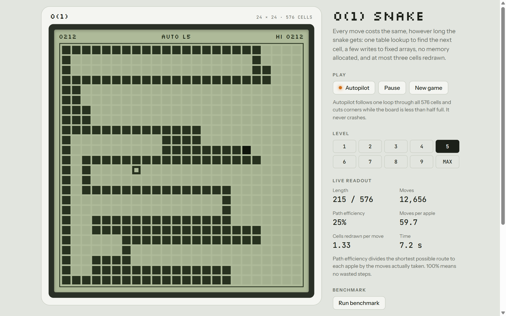
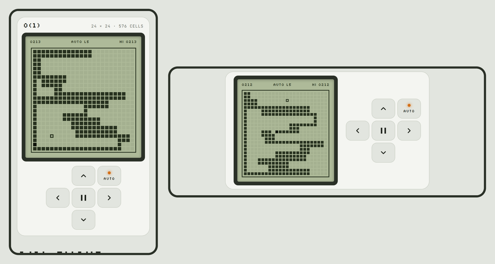

# O(1) Snake

A game of Snake built so that **every move costs the same, however long the snake gets**.
It is one file with nothing to install. Open `index.html` and play, on a computer or on a phone.

## Play

Download `index.html` and open it in a browser. There is nothing to build or install.

| | Keyboard | Touch screen |
|---|---|---|
| Steer | Arrow keys or `W` `A` `S` `D` | Swipe on the board, or use the pad |
| Start, pause, resume | `Space` | Tap the board, or the pad's middle button |
| Autopilot on or off | `Q` | `AUTO` on the pad |
| Speed | `1` to `9`, and `0` for MAX | The level buttons |
| New game | `Enter` | Tap the board when the game is over |

The **autopilot** plays by itself and never crashes. At MAX speed it fills all 576 cells in about 20 seconds.

When you are online the page loads its three fonts from Google Fonts. Offline it uses your system's fonts instead.
Nothing else is sent anywhere. Your best score and level are kept in the browser's own storage.

## Why "O(1)"

"O(1)" is how programmers write "takes the same time however big the job gets".

A simple Snake does more work as the snake grows. It walks the whole body to see whether you ran into yourself,
searches the board for a free cell for the next apple, and redraws everything. This one never searches:

| Each move needs | How it is done |
|---|---|
| The next cell | one lookup in a table worked out before the game starts |
| "Did I hit myself?" | one read from a grid that marks where the body is |
| Moving the body | two writes to a ring buffer; nothing is shifted along |
| The next apple | one random pick from a list of the free cells |
| New memory | none: every array is made once and reused |
| Redrawing | at most 3 of the 576 cells |

**Measured:** the built-in benchmark plays 10 complete games, about 420,000 moves, in under 20 thousandths of a second.
That is about **25 million moves per second on one processor core**, or about 40 billionths of a second per move, in plain JavaScript.
(Chrome 157 and Edge 157, Windows 11, AMD EPYC 9354, 14 November 2026: between 23 and 28 million across runs.
Press **Run benchmark** on the page to measure your own machine.)

## How the autopilot works

- The board has one fixed loop that passes through every cell exactly once. A snake that follows the loop can never run into itself.
- While the board is less than half full, the autopilot cuts across the loop towards the apple whenever that is safe.
  It never jumps past the apple or past its own tail.
- Once the board is half full it stops cutting corners and simply follows the loop.

It is a fixed rule, not a learning AI. Stopping the shortcuts at half full was tested against keeping them to the end:
about 42,600 moves to fill the board instead of about 79,000.

## On a phone

Held upright, the pad sits under the board. Held sideways, the pad moves beside it.
The pictures are from Chrome's phone emulation, not from a real phone.

## Tested

Checked on 14 November 2026 with `tests/phone-check.ps1`: 61 checks, all passing in both browsers.

| What | Result |
|---|---|
| Chrome 157 and Edge 157 on Windows 11, with keyboard and mouse | works |
| The same two browsers acting as phones and tablets: 13 screen sizes, upright and sideways, played with touch input (taps, swipes, two fingers) | works |
| The engine: 300 random games checked after every move, and 200 autopilot games | consistent; 200 of 200 boards filled |
| A real phone or tablet | **not tested** |
| Safari (Mac, iPhone, iPad) and Firefox | **not tested** |

"Acting as a phone" means the right screen size and real touch events, but it is still Chrome's engine on a PC.
It was worth doing. It found a board that shrank to 16 pixels when the phone was turned sideways, a second finger that
could steer the snake into a wall, and a pad that stopped the page from scrolling. All three are fixed.
It cannot show how Safari behaves, or what a real thumb does. If something is off on your device, please open an issue.

## The sequel

The same autopilot, squeezed into 12 bytes per game and run a billion times at once on one graphics card:
[1 Billion games of Snake](https://github.com/2Shay96/1-Billion-games-of-Snake).

## Files

- `index.html`: the whole game (engine, drawing, controls)
- `tests/`: the automated check and how to run it
- `docs/`: the pictures on this page
- `AGENTS.md`, `STATUS.md`: notes for the AI agents that work on this project

## Licence

[MIT](LICENSE): use it, change it, share it. Just keep the copyright notice.
